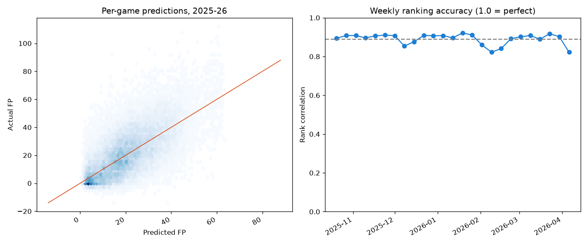

# Fantasy Basketball Weekly Projections

A machine learning model that projects how many fantasy points each NBA player
will score in an upcoming week, so you can decide who to start and who to pick
up off waivers.

Scoring follows ESPN's default points league (editable in `src/config.py`).

**Live dashboard: https://goofyanader.github.io/fantasy-basketball-ml/**: this week's rankings plus a
[draft rankings tab](https://goofyanader.github.io/fantasy-basketball-ml/#draft) for season-long drafts.

## How it works

1. **Data**: every player's box score from the last five NBA regular seasons,
   pulled from NBA.com with [`nba_api`](https://github.com/swar/nba_api).
2. **Features**: for each game, only information known *before* tip-off:
   - recent form (fantasy points and minutes over the last 3/5/10 games)
   - season-to-date and previous-season averages
   - efficiency (fantasy points per minute) and consistency (std. dev.)
   - schedule context: rest days, back-to-backs, home/away
   - opponent defense: fantasy points the opponent allowed over its last 20 games
   - **teammate absences**: the fantasy points usually produced by rotation
     teammates who are out tonight, and how that compares to the team's last
     10 games. When a star sits, the remaining players pick up his shots.
     Absences come from box scores in training (a regular missing from his
     team's box score was out) and from the injury report when predicting.
3. **Model**: a gradient-boosted tree regressor (scikit-learn) predicts
   fantasy points for each game.
4. **Weekly projection**: per-game predictions summed over each team's games that
   week. A player with 4 games often beats a better player with 2.
5. **Injury filter**: each game is weighted by the chance the player suits up,
   using ESPN's live injury report and each player's expected return date:

   | Situation | Chance of playing |
   |---|---|
   | Game before expected return date | 0% |
   | Out, no return date | 0% |
   | Out, but return date already passed (stale report) | 50% |
   | Day-to-day, first game on/after return date | 75% |
   | Day-to-day, later games / scheduled rest / healthy | 100% |

   An early version applied the day-to-day discount to every game in the week.
   In preseason, ESPN lists dozens of healthy stars as "day-to-day" because
   they're resting, and that version pushed Giannis from 14th to 52nd. The
   discount now applies only to real injuries, and only to the first game back.

## Evaluation

The model trains on 2021-22 through 2024-25 and is tested on the full 2025-26
season, which it never saw. It's compared against the baselines a fantasy
manager would use by eye:

| Approach | MAE, all games | MAE, key teammate newly out |
|---|---|---|
| Last 10 games average | 10.04 | 10.98 |
| Season average | 10.03 | 11.12 |
| Ridge regression | 9.62 | 10.20 |
| Gradient boosting, no absence features | 9.65 | 10.71 |
| **Gradient boosting** | **9.49** | **10.04** |

"Key teammate newly out" means teammates missing 40+ more fantasy points than
usual (3,838 of 26,547 test games). Without the absence features the model
under-projected players in those games by 5.0 points on average; with them,
by 0.9.

Single games are noisy (a star can score 30 or 90), so per-game error stays
high for any method. What matters for fantasy is ranking players over a week,
and there the model reaches an average **Spearman rank correlation of 0.89**
between projected and actual weekly totals.



Ranking accuracy dips around the February trade deadline, when players change
teams and roles faster than recent-form features can catch up.

### Bugs found along the way

- **Season openers looked like injury returns.** Rest days were capped at 7, so
  a player's first game after the offseason looked the same as a comeback from
  injury (usually limited minutes). Stars were under-projected by ~10 points on
  opening night. Fixed by measuring rest within a season only.
- **Missing values in tree models.** Before a player's first game, their season
  average is blank. Gradient-boosted trees send all blanks down one branch, which
  lumped stars in with bench players. Filling it with last season's average
  brought opening-night projections for stars from 41.8 to 46.2 FP (actual: 47.3).
- **A leak in the absence feature.** The first version filled each team's
  first game of a season with that season's *final* 10-game absence average,
  which is information from the future. Caught before training; only unplayed
  games are filled now.
- **Training vs. prediction mismatch.** Training first counted every player
  missing from a box score, including deep-bench players benched by the coach.
  Those never appear on an injury report, so at prediction time every game
  would have looked unusually healthy. Only rotation players (15+ minutes)
  count now, in both places.

## Draft rankings (season-long model)

A second model (`src/draft.py`) projects each player's full season for
drafting: **fantasy points per game × games played**, each predicted by its
own gradient-boosted model. Each row is one player-season; features come
only from earlier seasons (up to three prior years of scoring, minutes,
efficiency, usage, late-season form, games played, and age). Long-term
injuries remove the team games before a player's expected return date.

It trains on nine seasons (2017-18 onward). With one row per player per
season, the dataset is small (~3,500 rows), so the model type (ridge vs.
gradient boosting) is chosen on a validation season (2024-25) and results are
reported on a separate test season (2025-26):

| Drafting for 2025-26 | Avg. error, season total | Rank correlation | Top-100 hit rate |
|---|---|---|---|
| Last season's total | 525 | 0.681 | 60% |
| 3-year weighted average | 527 | 0.673 | 55% |
| **Our model** | **488** | **0.709** | **63%** |

Lessons from building it:

- **Games played is measured as a share of team games.** 2019-20 and 2020-21
  were shortened by COVID, so raw games played isn't comparable across seasons.
- **Players who missed a whole season** (e.g. Achilles injuries) had blank
  "last season" stats, which the tree model lumped in with fringe players.
  Haliburton was projected at 35 FP/game against his 47.5 before the injury.
  These features now come from the most recent season played, and
  `gp_share_1 = 0` still tells the model he sat out. He's now at 44.
- **Limitations:** rookies aren't ranked (no NBA stats yet), and the model
  can't see role changes from offseason trades.

## Usage

```bash
python3 -m venv .venv && source .venv/bin/activate
pip install -r requirements.txt

python -m src.data            # download game logs (cached in data/raw/)
python -m src.train           # train + evaluate, saves models/fp_model.joblib
python -m src.predict_week    # rankings for the coming Monday-Sunday week

# During the season: refresh this season's games, then re-project
python -m src.data --refresh
python -m src.predict_week --players "Jalen Brunson" "Scottie Barnes"
python -m src.predict_week --no-injuries   # assume everyone is healthy
python -m src.injuries                     # view the current injury report
python -m src.draft                        # backtest + train draft model, print top 30
```

### Updating the dashboard

The dashboard is a static page in `docs/`, built from `site/template.html`
and served by GitHub Pages. NBA.com blocks cloud servers, so it's rebuilt
locally once a week:

```bash
python -m src.build_site --refresh --publish   # new games -> rebuild -> push
```

## Limitations and next steps

- **Injury report quality**: ESPN's return dates are estimates and are
  sometimes stale. Check the notes (`python -m src.injuries`) for key players.
- **Season-long absences in training**: a player hurt before his team's first
  game never appears in that season's box scores, so training can't count him
  as missing.
- **Early season**: with few games played, the model leans on last season's
  numbers, so it's slow to catch new roles (trades, rookies).
